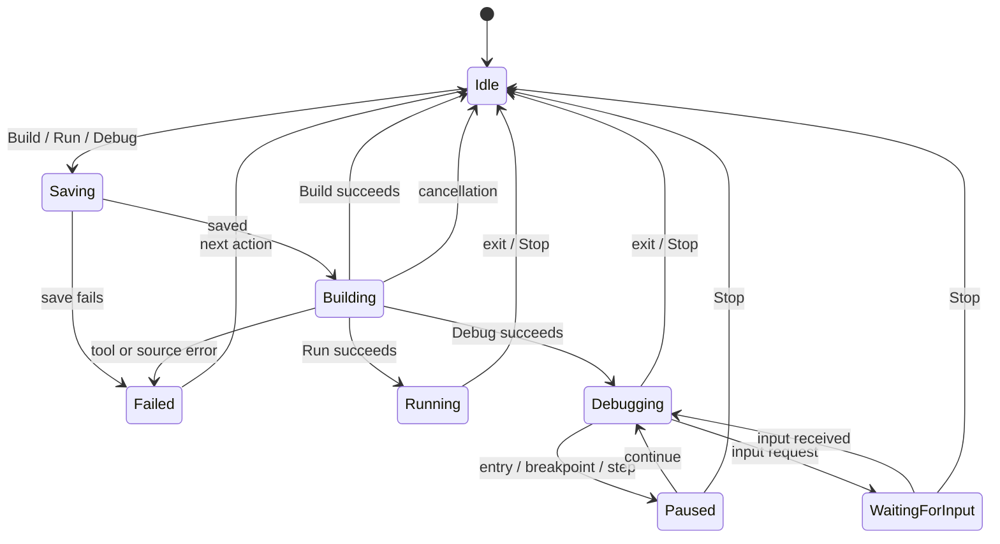

# Assembly IDE parity and editor modernization plan

Date: 2026-10-13. Status: baseline investigation complete; first implementation tranche in progress.

## 1. Outcome and scope

Make IDEARM comfortable for the professor's 8086/TASM exercises: open a folder, identify the main source,
build, run with readable output, and debug with predictable controls. Preserve IDEARM branding, its Java
application/domain layers, MASM and NASM support, and its educational tools. Bring the editing surface and
workbench proportions close to Visual Studio Code.

The references have different responsibilities:

- **Ensamblador IDE:** observable TASM/TLINK/DOSBox/Turbo Debugger workflow, simple tool setup, clear actions,
  and a calm, dark interface.
- **VS Code:** editing behavior, tabs, gutter, navigation, command palette, panels, and default shortcuts.
- **IDEARM:** identity, bilingual UI, project configuration, source intelligence, integrated emulator and
  native debugging. These already exist and should be connected and refined.

This plan describes behavioral parity and an independent implementation. No reference application code,
assets, proprietary executables, or the user's course projects have been added to the repository.

## 2. Evidence and limits

### Reference application

Read the supplied `C:\Codigo\Proyectos\Ide\Ensamblador IDE\resources\app.asar` without modifying it.
Its package declares Ensamblador IDE 0.1.0, Electron, and `monaco-editor ^0.55.1`.
The installed application's archive and the supplied archive have the same SHA-256:
`1633490101132322F4D9BA70D6653C79227A15A94C9FEF2D1CAD3E53170B7499`.

Inspected its main-process orchestration and renderer configuration. Used a separate application window
and an original, disposable `HELLO.ASM` under `scratch/reference-review/single` for UI verification.
The original window contained unsaved course work and was left intact.

| Behavior | Evidence | Result |
| --- | --- | --- |
| Build/Run/Debug need an active `.asm` tab | UI and renderer | Buttons disable with no source or an active `.inc` tab |
| Save before execution | Renderer inspection | Dirty active source prompts Save/Cancel; failure prevents that build |
| Build | Main-process inspection and Run click | TASM `/zi`, TLINK `/v`, assembly/link output and success result |
| Run builds first | UI | New HELLO produced OBJ/EXE/MAP, then opened DOSBox |
| Run output stays visible | UI | `IDEARM review OK`, followed by `Press any key to continue.` |
| Debug builds first | UI | Opened Turbo Debugger in DOSBox with the HELLO source and entry marker |
| Source stepping | UI | F7 advanced the entry marker from line 7 to line 8; CALL/RET and breakpoint scenarios remain in the acceptance suite |
| Stop external debug | UI | Closed both owned DOSBox windows and returned the reference IDE to idle |
| Multiple modules | Main-process inspection only | Detects `EXTRN` in the active file and adds sibling `.asm` files, sorted |
| Long link command | Main-process inspection only | Uses a TLINK response file above its inline command limit |
| One active session | Main-process and UI inspection | Build/run/debug share a process slot; Stop owns the active session |
| Editor | UI and renderer | Monaco, JetBrains Mono 13px, four-space tabs, folding, line numbers, word wrap, minimap disabled |

The application's terminal panel is a build/session log. Program interaction and CPU debugging happen in
the DOSBox window. It does not supply an integrated source-level debugger protocol to reproduce in Java.
It builds in the workspace; IDEARM should keep its existing staging model.

### IDEARM baseline verified in this session

- `mvn -o -B package -DskipTests`: **passed**, all ten reactor projects, version 2.0.0.
- Launched the newly packaged JavaFX application with its module path and an isolated
  `IDEARM_USER_DATA_DIR`; opened `examples/hello-input`.
- Clicked Debug: stopped at `src/main.asm:18`. Stepped once: moved to line 19, AX became `1014h`,
  instruction counter became 1. Continued: displayed `What is your name?` and waited for input.
- A real `a` key followed by Enter produced `Hello, a!` and exit code 0.
- Pasting `Ana` into the input field displayed it there but did not forward it to the emulated program.
  A subsequent real key was forwarded. This is a reproduced console-input gap.
- Tool Doctor found TASM, TLINK, Turbo Debugger, DOSBox 0.74-3, MASM/CodeView, NASM, ld and GDB.
- Ran 79 selected tests covering build freshness, build/run/debug orchestration, source expansion, DOSBox
  sessions, emulator input/faults, and debugger/workbench view models. 78 passed in the sandbox; one atomic
  save test raised `AccessDeniedException`. That same test passed when rerun outside the sandbox.
  This is not a full `mvn verify` or an exhaustive instruction compatibility result.

Local logs are in the ignored `scratch/reference-review/evidence/` directory. Existing uncommitted product
changes were present before the review; this proposal does not claim authorship or validation of all of them.

## 3. What to reuse and what to change

| Area | Existing IDEARM implementation | Planned work |
| --- | --- | --- |
| Build before Run/Debug | `FreshBuild`, `BuildProject`, `RunProject`, `DebugProject` | Preserve; fix save failure propagation and show phases clearly |
| TASM/MASM/NASM adapters | Toolchain modules and provider ports | Reuse; compare class fixtures and exact symbol/source behavior |
| DOS execution | DOSBox provider, staged resources, exit tracking | Respect project pause setting; expose a class workflow preset |
| External debugging | `DosBoxDebugEnvironmentProvider`, `DosBoxDebugSession` | Make Turbo Debugger choice obvious; verify source lookup, modules and resources |
| Integrated debugging | `Emu8086DebugSession`, `DebugViewModel`, `DebugCapability` | Improve controls, responsive panels and input; expand emulation only from measured course needs |
| Main source and modules | Project entry, source globs/exclusions, import, main-source chooser | Easier open-folder setup; visible entry source; reviewable module inference |
| Language intelligence | `idearm-language`, completion/hover/definition/lint use cases | Keep independent of the editor widget |
| Editor | RichTextFX behind `EditorComponent`, `EditorActions`, `CodeMinimap` | Visual improvements plus a measured Monaco alternative |
| Workbench | Activity bar, explorer, outline, tabs, palette, theme tokens | Refine layout density, action labels and debugger organization |

## 4. Review findings that determine priority

### P1 — A failed save can still launch an older program

`WorkbenchViewModel.startTask()` calls `saveAllQuietly()`. The helper catches `IOException`, logs it, and
returns; the caller then starts the build/run/debug work. A read-only file or failing write can therefore
leave newer text in the editor while the old on-disk source is executed.

Make saving a result-bearing prerequisite. On failure, preserve dirty buffers, show the affected file,
release the task guard, and do not call the build or launch use case. Test a save failure with a fake port
or controlled failure, independent of OS ACL details, and assert zero build/launch calls.

Source: `idearm-app/.../viewmodel/WorkbenchViewModel.java`, `startTask` and `saveAllQuietly`.
This is established by code inspection; the failing-save execution path was not manually reproduced.

### P2 — Normal Run bypasses the project's pause-on-exit setting

Toolbar, menu and command palette call `run(false)`. `runProgram()` passes that boolean to
`RunProject.execute()` as a non-null override. Consequently, normal desktop Run forces `keepOpen=false`
even when the project says `keep-open=true`. The application use case already supports a null override
to honor the project setting. This is a direct mismatch with the reference's visible final output.

Expose normal Run as “use project setting”; preserve explicit “pause on exit” and, if needed, “close on exit”
actions. Verify menu, toolbar, palette and shortcuts all use the same command contract.

Sources: `WorkbenchToolBar`, `WorkbenchMenuBar`, `WorkbenchView`, `WorkbenchViewModel.runProgram`,
`RunProject.execute`. Established by code inspection.

### P2 — Paste is disconnected from raw console input

`BottomPanelView.createProgramInput()` forwards `KEY_TYPED` events in key mode. Clipboard insertion changes
the TextField without generating those key events; Enter only sends `\r`, leaving the pasted text unsent.
Route paste explicitly to the same input sink, normalize line endings, and ensure characters are sent
exactly once. Verify paste, actual typing, Backspace, Enter, and Stop while waiting.

### UX — Debug information is cramped at the default window size

At the observed 1280-class window size, register headings and the disassembly tab truncate, while controls
appear both in the top bar and the register panel. Preserve the data, but give the debugger a dedicated
layout with a resizable sidebar, one control strip, and a memory/disassembly area that can be expanded.

### Compatibility boundary — Graphics and DOS files

The integrated emulator is not a full DOSBox replacement. The current implementation warns for unsupported
DOS/BIOS services, and some unsupported calls return without implementing the service. Graphics exercises
and file-based resources must have a reliable DOSBox/Turbo Debugger path. A green build does not prove the
integrated emulator can run the resulting program correctly.

For known unsupported operations, prefer an explicit compatibility message and a user-selected external
backend. Do not silently change the project's backend or promise complete DOS/BIOS compatibility.

## 5. Proposed user workflow

### Opening a class exercise

1. Open Folder detects `idearm.toml`; existing projects keep their configuration.
2. For an unconfigured folder, preview a proposed DOS/TASM configuration with main file, modules, includes
   and runtime resources. Reuse `ImportProject`; create configuration only when the user applies the preview.
3. Show the selected main source beside the Run/Debug selector. Opening an include or helper module must
   not silently change which program runs.
4. Offer **Class compatibility: DOSBox + Turbo Debugger** and **Integrated 8086 learning** presets.
   Existing projects retain their backend. For a newly imported TASM class exercise, recommend the class
   preset when Turbo Debugger is available. Show a concrete missing-tool action otherwise.

Do not blindly compile all sibling `.asm` files merely because `EXTRN` appears. Suggest candidates, retain
explicit project modules/exclusions, and show the final source list and entry before the first build.

### Build, Run and Debug contract



This is a UI contract, not a requirement to replace the current session classes. External debugger pause
states are unknown to IDEARM; show “Debugging in Turbo Debugger” without manufacturing internal state.

- Build reports saving, assembling, linking, diagnostics and artifact location.
- Run honors freshness and project output persistence; never launches after a failed build or failed save.
- Debug chooses the configured backend and displays its name before launch.
- Stop cancels only the owned build/session; controls reset even after failed launch or closed DOSBox.
- Integrated mode offers entry stop, breakpoints, continue/pause, step into/over/out, restart, registers,
  flags, memory, stack, disassembly, watches and input according to existing capabilities.
- External mode offers launch/stop plus a compact Turbo Debugger shortcut guide. IDEARM breakpoints and
  register panels do not control Turbo Debugger; explain this where the backend is selected.
- Preserve the existing VS Code-style keys: F5 debug/continue, Ctrl+F5 run, Shift+F5 stop, F9 breakpoint,
  F10 step over, F11 step into, Shift+F11 step out. Keep F7/Ctrl+Shift+B build for compatibility.
  Turbo Debugger retains its own F7/F8/F9 keys inside its window.

## 6. Editor and visual design

### Visual specification to implement first

- Keep the IDEARM mark and blue accent. Use existing palette tokens as the base; avoid an unrelated redesign.
- Continuous workbench surfaces and subtle separators, with restrained rounding in dialogs and inputs.
  The reference's spacious card framing should not take space away from code.
- Target proportions: 44–48px activity rail, 240–280px resizable sidebar, 34–36px editor tabs,
  22–24px status bar. These are proposed metrics, not measurements claimed for either reference.
- Editor: selectable monospaced font at 13–14px, readable 20–22px line height, aligned line numbers,
  indentation guides, current-line highlight, clear selection and diagnostic squiggles.
- Distinct gutter marks for breakpoints and execution; use shape as well as color. Keep inline errors legible.
- Offer minimap and wrapping as preferences. Preserve user settings and editor position per tab.
- Give Run and Debug discoverable labels/tooltips and an adjacent backend/entry selector; compact at narrow
  widths. Use a single active debug control strip with stable placement.
- Explorer gets filters for generated OBJ/EXE/MAP/LST files and internal state; user can reveal them.
- Separate build log, program output and shell terminal by behavior and labels. Keep Problems navigable.
- Check English/Spanish and dark/light themes at 100%, 125%, 150% and 200% Windows scaling, plus narrow and
  maximized layouts. No hidden essential controls or clipped register values.

### Monaco decision gate

Monaco is the strongest candidate for close VS Code editing behavior. Microsoft documents that it is
generated from VS Code sources, while the workbench and VS Code extensions are separate concerns.
See the [official Monaco repository](https://github.com/microsoft/monaco-editor) and its
[ESM integration guidance](https://github.com/microsoft/monaco-editor/blob/main/docs/integrate-esm.md).

ADR-005 previously selected RichTextFX on measured latency; Monaco was not measured. The new request makes
editing fidelity a stronger requirement, so reopen the evaluation rather than treating that prior choice
as proof Monaco cannot work.

Build a separate prototype behind `EditorComponent` before changing the production default:

1. Inventory concrete RichTextFX casts and `EditorActions` dependencies in views/view models; move required
   operations behind a tested editor contract, without moving JavaFX below Presentation.
2. Test Monaco hosting in JavaFX WebView with local resources and worker loading. Do not assume browser API,
   clipboard, font, IME or worker compatibility. If it fails, record the failure and compare a Chromium host
   with the cost of retaining RichTextFX; any shell migration needs a separate architecture decision.
3. Connect editor models to Java-owned documents using URI, document version and change events. Ignore stale
   lint/completion responses; avoid a full-file round trip on every keystroke.
4. Bridge completion, hover, diagnostics, definitions, references, outline, breakpoint decorations and
   execution line. Reuse `idearm-language`, not the reference application's implementation.
5. Verify multicursor, rectangular selection, folding, find/replace with regex, undo/redo, snippets, formatting,
   comment toggling, line movement/duplication, indentation, Unicode, and encoding-preserving save.
6. Benchmark current RichTextFX and the candidate on the same machine and 5k/20k-line sources: proposed gates
   are p95 typing latency below 50ms, 5k-line open below 1s, no UI stalls on lint, and recorded startup/RAM/
   package-size impact. Repeatedly open/close tabs to detect retained models/listeners.
7. Keep RichTextFX available until the candidate passes the behavioral and performance gates. If Monaco
   cannot pass in the chosen host, deliver the visual improvements and identify the remaining editor gaps
   explicitly; do not claim identical VS Code behavior.

Assembly formatting must preserve quoted strings, numeric literals, labels, macros, data directives and
comments. It must not rewrite valid dialect syntax into a cosmetically preferred but invalid program.

## 7. Implementation sequence and acceptance gates

### First implementation tranche (2026-10-13)

The user authorized implementation and collaboration with Antigravity after the initial comparison.
Codex owns the execution fixes; Antigravity received a bounded visual-debugger task through its desktop app
in the conversation **Visual Debugger Implementation for IDEARM**. Shared-file ownership keeps its changes
in `DebuggerPanelView`, debugger CSS, a focused test and a review document; Codex performs combined validation.

- Save errors now abort the task before any build, run or debug use case starts. The dirty editor remains
  available, the failure identifies the file in English/Spanish, and the task slot is released for retry.
- Normal Run in the menu, toolbar and command palette now honors the project's `keepOpen` setting.
  Explicit Run with pause still supplies a per-run override.
- Pasting into the integrated keyboard console sends the clipboard once, with CRLF/LF converted to DOS CR.
  Line-oriented processes still buffer pasted text until Enter. Program output remains responsible for echo.
- Regression coverage exercises denied saves and retry, keyboard versus line-mode paste, pause configuration,
  and translation completeness. Final reactor and desktop validation are recorded below when complete.

These changes cover the initial M1 defects. The remaining milestones are acceptance gates, not completed
features; in particular, no Monaco implementation or claim of full DOS compatibility is implied.

### Remaining roadmap

Effort is a planning estimate in focused engineering days, excluding review and unexpected compatibility
work. The Monaco branch is deliberately estimated separately.

| Milestone | Scope and principal files | Dependency | Acceptance gate | Estimate |
| --- | --- | --- | --- | --- |
| M0: baseline | Add original fixtures and a reproducible comparison record; keep logs outside tracked source | This review | Same fixture and tool versions identified in both apps; document untested cases | 1–2 days |
| M1: reliable execution | `WorkbenchViewModel`, menu/toolbar/palette commands, `RunProject`, `BottomPanelView` | M0 | Failed saves prevent launch; Run honors pause setting; paste/keys/Stop work | 2–3 days |
| M2: class workflow | `ImportProject`, project properties/new-project UI, tool doctor, main-source selector, `SourceSet` | M1 | Open-folder preview, main/modules/includes/resources are explicit; TASM fixtures build/run | 2–4 days |
| M3: debug parity | `DebugProject`, DOSBox debug provider, `DebugViewModel`, `DebuggerPanelView`, emulator only as needed | M2 | TD source/step/breakpoint/reset verified; integrated capabilities and limits visible | 3–5 days |
| M4: visual refinement | `WorkbenchView`, editor area, toolbar, explorer, debugger layout, CSS, both message bundles | M1; informed by M3 | Agreed editor/layout checklist, themes/languages/scaling pass | 2–4 days |
| M5: editor prototype | `EditorComponent`, editor actions/factory, isolated hosting prototype; proposed amendment to ADR-005 | M0; can precede M4 details | Measured Monaco go/no-go decision and editor contract tests | 2–4 days |
| M6: editor integration | Accepted editor host, language bridge, settings, disposal and packaged resources | M5 passes | Editing and debugging regression checklist passes offline in packaged app | 5–10 days |
| M7: release verification | Guides, examples, packaging, `mvn verify`, real tools and installer/portable smoke | M1–M4; M6 if selected | Reproducible build, clean-machine tool setup, no proprietary tools bundled | 2–3 days |

Recommended delivery: first ship M1–M4 as functional/classroom improvements; switch the editor only after
M5–M6 pass. This avoids making working assembly execution depend on an unproven browser host.

Each milestone should produce a small reviewable change with behavior, affected files and relevant tests.
When PRs exist, the Code Review plugin can inspect their CI checks; the current local comparison has no PR.

## 8. Acceptance suite

| Fixture/scenario | Expected result | Required environments |
| --- | --- | --- |
| Hello and exit | Same text and program exit; output remains readable | Reference Run, IDEARM DOSBox |
| Character and buffered input | Correct echo, Enter/Backspace, no input invented, pasted input delivered once | DOSBox and integrated emulator |
| Arithmetic and flags | AX/BX/CF/ZF/SF/OF values match at defined stops | Turbo Debugger and integrated emulator |
| CALL/RET and loop | Into/over/out and repeated breakpoint behavior correct | Turbo Debugger and integrated emulator |
| Infinite loop | Pause works where supported; Stop always ends the owned session | All backends |
| Multi-module EXTRN/PUBLIC | Correct entry, one assembly per module, deterministic link order | Both IDEs with TASM |
| INCLUDE and nested folders | Source lookup and diagnostics point to the actual included file | TASM/MASM and both debug modes |
| Resource file / mode 13h graphics | Works through DOSBox; integrated limitations explained | Class backend; integrated boundary test |
| Deliberate syntax/link errors | Clickable correct file/line; no older EXE runs | All build paths |
| Save denied / stale artifact | Dirty text preserved, no build/launch; subsequent retry works | UI orchestration regression tests |
| Spaces, accents, long file names | Supported path handling or actionable diagnostics, preserved encoding | Windows tool integrations |
| Repeated run/debug/stop/restart | No duplicate session, stale markers, orphan processes or stuck controls | All backends |
| External debugger source symbols | `/zi` and `/v` build displays correct source after staging | IDEARM Turbo Debugger |
| Editor bridge | Same completion/lint/hover/navigation and no dropped edits | Current and candidate editor |
| Native regression | Existing Windows NASM/GDB fixture still builds/runs/debugs | Native profile |

Use small original fixtures with expected output, stop locations and register values. Record instruction/
interrupt requirements for each class exercise. Build an emulator support matrix from these results;
do not estimate full x86/DOS compatibility from a successful hello-world test.

## 9. Build and launch runbook

Standard development workflow from the repository root:

```powershell
java -version
mvn -version
mvn install -DskipTests
mvn -f idearm-app/pom.xml javafx:run
```

Maven must use JDK 25+. The install step refreshes dependent project modules before `javafx:run`.
The initial install attempt in this review could not write the sandbox-protected Maven cache. Dependencies
were already cached, so the verified alternative was packaging the complete reactor offline and launching
the resulting jars directly:

```powershell
mvn -o -B package -DskipTests
$env:IDEARM_USER_DATA_DIR = Join-Path $PWD 'scratch\reference-review\idearm-user'
$env:IDEARM_SMOKE_PROJECT = Join-Path $PWD 'examples\hello-input'
$appJar = Get-ChildItem 'idearm-app\target\idearm-app-*.jar' |
    Where-Object { $_.Name -notmatch '-(sources|javadoc|tests)\.jar$' } |
    Select-Object -First 1 -ExpandProperty FullName
$modulePath = $appJar + ';' + (Join-Path $PWD 'idearm-app\target\lib')
java '-Djavafx.enablePreview=true' `
    '--enable-native-access=javafx.graphics,io.github.dinamo541.idearm.app,io.github.dinamo541.idearm.infrastructure' `
    --module-path $modulePath `
    -m 'io.github.dinamo541.idearm.app/io.github.dinamo541.idearm.app.App'
```

Use a fresh PowerShell session for normal startup, or remove the two session-specific environment overrides
after this test. `IDEARM_USER_DATA_DIR` isolates UI preferences/history; project-local state and the external
tool registry are separate. Offline packaging works only when the needed dependencies are already cached.

In the UI, open Tool Doctor, then `examples/hello-input`. F5 starts the integrated debugger; F11 steps;
F5 continues to input; type a name and press Enter. For classroom compatibility choose the external debugger
in Project Properties. Normal Run now respects the project's pause-on-exit setting; **Run → Run (Pause on
Exit)** explicitly requests it for that invocation.

Selected tests used in this review:

```powershell
mvn -o -B test -pl idearm-app -am `
  '-Dtest=FreshBuildTest,BuildProjectTest,RunProjectTest,DebugProjectTest,SourceSetTest,Emu8086DebugSessionTest,Emu8086FaultsAndInputTest,DebugViewModelTest,WorkbenchViewModelTest,DosBoxDebugEnvironmentProviderTest,DosBoxRunSessionTest' `
  '-Dsurefire.failIfNoSpecifiedTests=false'
```

Before a product release run `mvn verify`, the relevant `local-tools` integration tests, and the packaged
application smoke checks. The existing `scripts/package-native.ps1` remains the packaging entry point;
building a release installer was outside this investigation.

## 10. Decisions to record during implementation

- Amend ADR-005 only after the editor experiment; current production editor remains RichTextFX.
- Record the new-class-project preset and save/run semantics as an amendment to ADR-010 or a new ADR.
- Keep existing project backends and bindings stable; new UI must not silently migrate them.
- New UI labels, errors and accessibility names must exist in both English and Spanish bundles.
- Register the user's installed assembly tools; keep proprietary binaries outside source control/packages.
- Use the [official VS Code debugging reference](https://code.visualstudio.com/docs/debugtest/debugging)
  and [keybindings reference](https://code.visualstudio.com/docs/reference/default-keybindings) for the
  editing/debug controls, while explicitly documenting Turbo Debugger's separate keymap.

M1's save-before-launch, pause-on-exit and console input corrections are implemented. On 2026-10-14 the
focused regression suite passed 57 tests and the ten-module offline package passed. Desktop QA confirmed
entry pause, resume, pasted `Ana`, `Hello, Ana!`, and exit zero in hello-input. Duplicate terminal output was
found during that test and assigned for a separate lifecycle correction.

Four Antigravity chats are implementing the debugger view, emulator conformance suite, isolated editor
prototype and application terminal-event fix under separate file ownership. Their artifacts require Codex
review and integration tests before acceptance. The prototype is not a production editor migration; full
reactor and visual verification remain outstanding after those changes settle.
